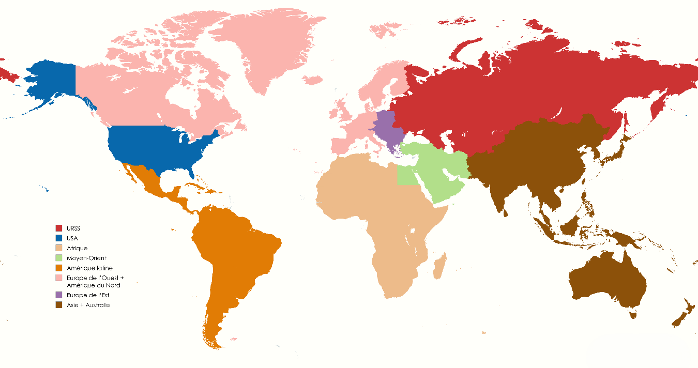
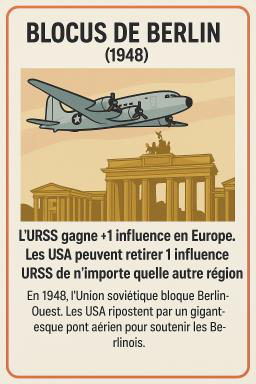
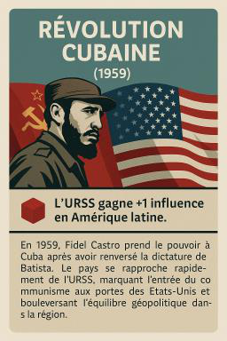
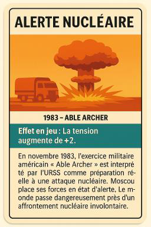

# Five Minutes to Midnight

### A Cold War strategy game about decision-making under uncertainty

**An educational board-game prototype exploring how competing superpowers pursue geopolitical influence without triggering a nuclear catastrophe.**

Two players take the roles of the **United States** and the **Soviet Union**. They compete for influence across five world regions, respond to historical crises, and negotiate under a shared nuclear-escalation constraint. The dilemma is deliberate: a move that strengthens your position can also make the entire game more dangerous.

> **Project status:** Designed tabletop-game prototype (2025), **not a digital or playable software application**. The repository contains the original 34-page design report and sample game artwork. The report describes limited conceptual/short-turn testing, not a completed public playtest or validated game balance.

[**Read the complete game-design report (PDF)**](docs/5-minutes-to-midnight-game-design-report.pdf)



*An illustrative board-map concept reproduced from the original report. The playable game abstracts geography into five strategic regions.*

## Project at a glance

| | |
|---|---|
| **Project type** | Educational strategy board-game design / paper prototype |
| **Theme** | Cold War, nuclear deterrence, diplomacy and competition |
| **Players** | 2 players or 2 teams: USA vs USSR |
| **Estimated playtime** | Approximately 45–60 minutes |
| **World model** | Europe, Asia, Middle East, Africa and Latin America |
| **Game materials** | Influence tokens, nuclear-tension track, 10 historical event cards, reference sheets |
| **Developed** | May 2025, Sciences Po Lyon (Institut d'Études Politiques de Lyon) |

## The design question

**How do you win a strategic rivalry when pushing too hard could make everyone lose?**

I created *Five Minutes to Midnight* for the course *CS – Modéliser pour décider dans l'incertitude*. The aim was to translate abstract ideas from international relations and game theory into decisions that players can experience. Rather than representing every country or historical episode, the game uses a small number of regions, short action menus and a shared crisis meter.

This is a deliberately simplified **teaching model**, not a historically exhaustive simulation or a quantitative prediction of Cold War events.

## How the game works

Every round starts with a **historical event card** whose effect changes influence or nuclear tension. After that, each side chooses one of three actions:

| Action | Effect | Strategic trade-off |
|---|---|---|
| **Influence** | Place **2** of your influence tokens in one or more regions | Expand peacefully, without directly raising nuclear tension |
| **Coup / Conflict** | Replace **1** opposing token with **1** of your own in the same region | Shift the balance quickly, but raise tension by **1** |
| **Détente / Negotiation** | Lower tension by **1** (minimum 0) | Preserve stability; the design also describes an **optional** small diplomatic influence bonus |

The shared nuclear-tension meter runs from **0 to 5** and ordinarily begins at **1**. Reaching **5** triggers a nuclear-war end condition. In the proposed rules, the side responsible for causing that escalation loses, highlighting the danger of brinkmanship.

A regular game lasts around **8–10 rounds**. At the end, the side controlling the most valuable regions wins on points. The report proposes **2 points each for Europe and Asia** and **1 point each** for the Middle East, Africa and Latin America; this weighted scoring is an optional design choice. Players can negotiate and make promises throughout, but agreements are not binding.

For the full setup, scoring variants, early-win conditions, and clarifications, see **Part 2** of the [original report](docs/5-minutes-to-midnight-game-design-report.pdf). The source includes optional rules and some areas that would need clarification before a formal published rulebook.

## Historical event cards

The design includes **10 historical event cards** spanning events such as the Berlin Blockade, Korean War, Cuban Missile Crisis, détente, and the 1983 nuclear alert. Events introduce abrupt shocks that can change the incentives behind the next decision.

| Berlin Blockade (1948) | Cuban Revolution (1959) | Nuclear Alert (1983) |
|:---:|:---:|:---:|
|  |  |  |

*Selected card illustrations extracted from the original design report; these are not screenshots of a digital game.*

## Concepts behind the mechanics

- **Security dilemma:** moves aimed at strengthening one side can make the overall situation less secure.
- **Nuclear deterrence and mutually assured destruction:** catastrophic escalation places a limit on aggressive strategies.
- **Brinkmanship and strategic uncertainty:** players must consider both immediate gains and their opponent's possible response.
- **Negotiation, trust and cooperation:** temporary restraint can serve both rivals even when their objectives conflict.
- **Model simplification:** five regions and three possible actions make strategic trade-offs accessible to learners without an international-relations background.

These are **pedagogical connections** developed in the report, not empirical tests of the theories.

## Design process and current limitations

The original assignment documents the design rationale, the reduction from a more complicated initial concept, simplified rules, expected player behavior, discussion questions, and printable visual material. It also discusses inspiration from *Twilight Struggle* and other strategy games.

At the time of writing, the game had undergone **limited tabletop/conceptual testing**, but **not a full-scale playtest with a student audience**. Historical detail is compressed, balance remains provisional, and several rule options would need to be standardized for broader distribution. No executable application is included.

The report also transparently describes **AI assistance** for brainstorming, wording checks, and some illustrative assets; the final game-design choices were made by the author.

## Repository structure

```text
5-Minutes-to-Midnight/
├── README.md
├── docs/
│   └── 5-minutes-to-midnight-game-design-report.pdf
└── assets/
    ├── cold-war-board-map.png
    └── event-cards/
        ├── berlin-blockade.png
        ├── cuban-revolution.png
        └── nuclear-alert-1983.png
```

## Project credits

**Game design and report:** Badr El Jaouhari  
**Course:** CS – Modéliser pour décider dans l'incertitude  
**Institution:** Institut d'Études Politiques de Lyon (Sciences Po Lyon)  
**Academic supervision:** Pr. David Vallat  
**Date:** May 2025

This repository presents an original academic game-design exercise; it is not affiliated with or endorsed by the publishers of the commercial games discussed as inspirations in the report.